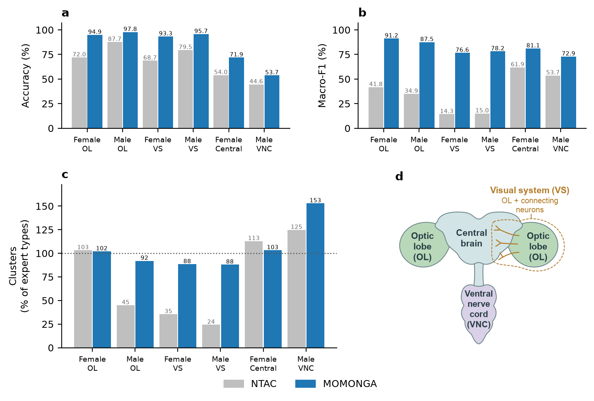

# MOMONGA

MOMONGA (MDL Optimization for Mapping Of Neuronal Groups from Adjacency) is a fully unsupervised method
for discovering neuronal cell types from connectivity alone which considerably improves over the state of the art ([NTAC](https://doi.org/10.1038/s41467-025-68044-1)). It uses the minimum description length (MDL)
principle to identify types through the compression afforded by their shared connectivity: the best
partition of neurons into clusters is the one that allows the connectome to be described most
concisely.

Paper: [Unsupervised neuronal cell typing from connectivity by minimum description length](https://doi.org/10.64898/2026.10.20.760604) (bioRxiv, 2026).



MOMONGA has two functions, refinement and transfer.

**Refinement** takes a coarse initial partition and improves it by iteratively splitting and merging clusters. The initial partitions come from NTAC (https://github.com/BenJourdan/ntac). This package includes its
own implementation of unseeded NTAC, which produces the same partitions as the original and runs much faster, with Metal and CUDA kernels.

**Transfer** takes two graphs and their partitions, corresponding to similar anatomical regions from
different specimens or from opposite sides of the same connectome. It automatically determines which partition is better and uses that to improve the accuracy of the other partition.


## Install

```bash
git clone https://github.com/gregoryschwartzman/momonga && cd momonga
python -m venv .venv && .venv/bin/pip install -e .      # add ".[metal]" on Apple silicon
```

## Quickstart

A stochastic block model with six types, typed from its connectivity alone, in seconds:

```python
import numpy as np
from scipy import sparse
from momonga import GraphData, Momonga

n, n_types = 1500, 6
rng = np.random.default_rng(0)
types = np.arange(n) % n_types
probability = rng.random((n_types, n_types)) * 0.1                 # each pair of types has its own edge probability
edges = rng.random((n, n)) < probability[types[:, None], types[None, :]]
np.fill_diagonal(edges, False)
A = sparse.csr_matrix(edges.astype(np.float32))
A.data = rng.integers(5, 13, size=A.nnz).astype(np.float32)        # synapse counts

data = GraphData(A, labels=types)                 # the labels are for scoring only
model = Momonga(data.without_labels())            # the method gets a graph without them
model.unseeded_ntac(12)                           # NTAC up to twice the true number of types
model.refine(grid=(6, 12))                        # refine two NTAC starts; the shorter description length is kept
print(data.get_metrics(model.ntac_partition()))   # NTAC's own answer
print(data.get_metrics(model.partition))          # MOMONGA's
```

`examples/optic_lobe.py` runs two optic lobes and a transfer between them, minutes on a laptop; it
downloads the paper's graphs (108 MB) the first time it runs.

## Citation

```bibtex
@article{schwartzman2026momonga,
  title   = {Unsupervised neuronal cell typing from connectivity by minimum description length},
  author  = {Schwartzman, Gregory},
  journal = {bioRxiv},
  year    = {2026},
  doi     = {10.64898/2026.10.20.760604}
}
```

MIT license, see [LICENSE](LICENSE).
